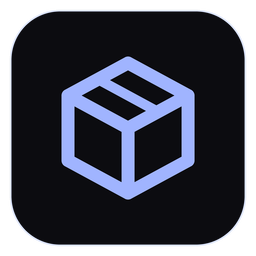
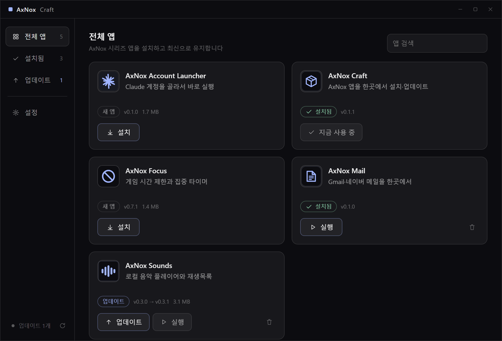
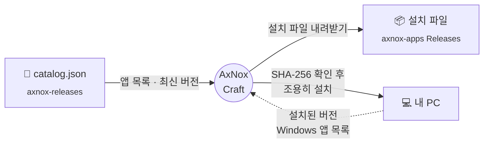

# AxNox Craft

**AxNox 시리즈 앱을 한 곳에서 설치하고, 실행하고, 최신으로 유지하는 Windows 앱**

### [⬇ Craft 내려받기](https://github.com/AxisNox42/axnox-releases/releases/latest)

 

 

## 이런 앱이에요

앱마다 GitHub를 찾아가서 설치 파일을 받고, 새 버전이 나왔는지 일일이 확인할 필요가 없습니다.
Craft 하나만 깔아 두면 나머지는 버튼 한 번입니다.

| | |
|---|---|
| ⬇️ **한 번에 설치** | 카드의 **설치**를 누르면 내려받기 → 파일 검사 → 설치까지 알아서 합니다. 설치 창도 뜨지 않아요. |
| 🔄 **업데이트 알림** | 새 버전이 있는 앱엔 `업데이트` 표시가 붙고, **모두 업데이트**로 한꺼번에 올릴 수 있습니다. |
| 🛡️ **변조 검사** | 받은 설치 파일의 SHA-256을 목록 값과 비교해서, 하나라도 다르면 설치하지 않습니다. |
| ▶️ **실행 · 제거** | 설치된 앱은 Craft에서 바로 실행하고, 지울 수도 있습니다. 지워도 앱 설정·데이터는 남아요. |
| ♻️ **Craft 자체 업데이트** | Craft도 목록에 있는 앱이라, 새 버전이 나오면 스스로 바꾸고 다시 켜집니다. |
| 🗂️ **설치 위치 지정** | 새 앱을 깔 폴더를 고를 수 있고, 업데이트는 원래 설치된 곳에 덮어씁니다. |

 

## 설치

1. **[Releases](https://github.com/AxisNox42/axnox-releases/releases/latest)** 에서 `AxNox.Craft_x.y.z_x64-setup.exe` 를 받습니다.
2. 받은 파일을 실행합니다. 내 계정에만 설치되므로 **관리자 권한이 필요 없습니다.**
3. Craft를 열고, 원하는 앱의 **설치** 를 누르면 끝.

> [!NOTE]
> 설치 파일에 코드 서명이 없어서 처음 실행할 때 **"Windows의 PC 보호"** 창이 뜰 수 있습니다.
> **추가 정보 → 실행** 을 누르면 설치가 계속됩니다.

 

## Craft로 받을 수 있는 앱

| | 앱 | 설명 |
|:-:|---|---|
| 📦 | **AxNox Craft** | AxNox 앱을 한곳에서 설치·업데이트 |
| 🎵 | **AxNox Sounds** | 로컬 음악 플레이어와 재생목록 |
| ✉️ | **AxNox Mail** | Gmail·네이버 메일을 한곳에서 |
| ⏱️ | **AxNox Focus** | 게임 시간 제한과 집중 타이머 |
| ✳️ | **AxNox Account Launcher** | Claude 계정을 골라서 바로 실행 |

새 앱이 나오면 Craft 목록에 자동으로 나타납니다. 따로 Craft를 업데이트할 필요도 없어요.

 

## 어떻게 동작하나요

- **앱 목록**은 이 저장소의 [`catalog.json`](catalog.json) 하나입니다. 앱 이름·설명·최신 버전·설치 파일 주소·SHA-256이 들어 있습니다.
- **설치 파일**은 Craft만 이 저장소의 [Releases](https://github.com/AxisNox42/axnox-releases/releases)에, 다른 앱은 [**axnox-apps**](https://github.com/AxisNox42/axnox-apps/releases)에 있습니다.
- **설치 여부와 버전**은 Windows의 *설치된 앱* 목록에서 읽어 오므로, Craft 없이 직접 설치한 앱도 알아봅니다.

 

## 자주 묻는 질문

<b>앱을 지우면 설정도 사라지나요?</b>

 

아니요. 제거는 프로그램 파일만 지우고, 앱 데이터(`%APPDATA%\<앱 이름>`)는 남겨 둡니다. 다시 설치하면 그대로 이어서 쓸 수 있어요.

<b>설치 파일을 Craft 없이 직접 받고 싶어요</b>

 

[axnox-apps Releases](https://github.com/AxisNox42/axnox-apps/releases)에서 원하는 앱의 `*-setup.exe` 를 받아 실행하면 됩니다. 이렇게 설치한 앱도 Craft가 알아보고 업데이트해 줍니다.

<b>다른 앱 목록을 쓰고 싶어요</b>

 

**설정 → 앱 목록 주소** 에 다른 `catalog.json` 의 웹 주소나 PC 안의 파일 경로를 넣으면 됩니다. 비워 두면 이 저장소의 기본 목록으로 돌아옵니다.

<b>목록을 못 불러온다고 나와요</b>

 

인터넷 연결을 확인하고, 사이드바 아래의 새로고침(↻)을 눌러 보세요. 목록을 못 받아도 이미 설치된 앱은 그대로 보이고 실행할 수 있습니다.

 

## 저장소 구성

| 저장소 | 들어 있는 것 |
|---|---|
| **[axnox-releases](https://github.com/AxisNox42/axnox-releases)** (여기) | Craft 설치 파일, 앱 목록 `catalog.json` |
| **[axnox-apps](https://github.com/AxisNox42/axnox-apps)** | Sounds · Mail · Focus · Account Launcher 등 다른 앱 설치 파일 |

 

AxNox Series · Windows 10/11 x64

